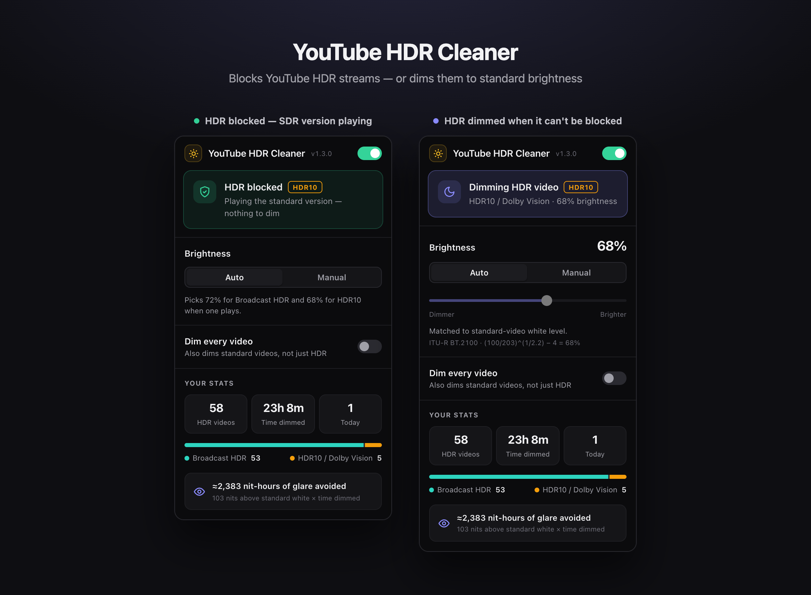
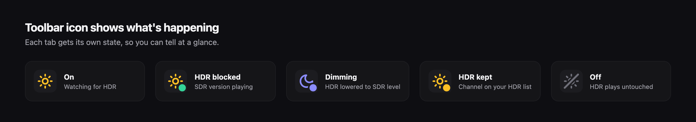

<p align="center">
  
</p>

<h1 align="center">YouTube HDR Cleaner</h1>

<p align="center">
  <strong>Fix YouTube HDR videos that are too bright.</strong><br>
  Blocks HDR10, Dolby Vision &amp; HLG on YouTube — or dims them to standard brightness.
</p>

<p align="center">
  <a href="https://github.com/iRajatDas/youtube-hdr-cleaner/releases/latest"></a>
  <a href="https://github.com/iRajatDas/youtube-hdr-cleaner/commits/main"></a>
  <a href="https://github.com/iRajatDas/youtube-hdr-cleaner/stargazers"></a>
  <br>
  
  
  
  
  
</p>

<p align="center">
  <a href="https://github.com/iRajatDas/youtube-hdr-cleaner/releases/latest"></a>
</p>

YouTube HDR Cleaner is a free Chrome extension that stops HDR videos on YouTube from blinding you on HDR displays (MacBook Pro XDR, HDR monitors, OLED laptops). It forces the standard (SDR) version of the video, or dims HDR to normal brightness when it can't.

Works with **HDR10**, **Dolby Vision** (PQ) and **HLG** (Broadcast HDR), in
Chrome and Chromium-based browsers such as Brave and Edge.



## Install

1. Download `youtube-hdr-cleaner-<version>.zip` from the
   [latest release](https://github.com/iRajatDas/youtube-hdr-cleaner/releases/latest).
2. Unzip it.
3. Open `chrome://extensions` (or `brave://extensions`, `edge://extensions`)
   and turn on **Developer mode**.
4. Click **Load unpacked** and select the unzipped folder.
5. Reload any open YouTube tabs.

## Why YouTube HDR looks too bright

On an HDR display, YouTube HDR videos are mastered for a much higher peak
brightness than everything else on screen. Highlights and even mid-tones end
up far brighter than standard videos, the YouTube interface and the rest of
your desktop, which is uncomfortable — especially in a dark room. YouTube has
no setting to turn HDR off.

## How YouTube HDR Cleaner fixes it

1. **Block HDR** — removes HDR formats from YouTube's player data before the
   player sees them, so YouTube plays the SDR version of the video at normal
   brightness. No quality setting to change, no extra decoding.
2. **Dim HDR** — if an HDR stream still plays (for example an HDR-only
   upload), a dark overlay lowers it to standard-video brightness, using a
   level derived from the ITU-R BT.2100 reference white.

## Features

- Disable HDR on YouTube automatically: blocks HDR10, Dolby Vision and HLG streams
- Works on direct links and in-app navigation (search, home, recommendations)
- Auto brightness for HDR that can't be blocked, or set it manually
- Turn it on or off mid-video — the video reloads at the same position with or without HDR
- Optional "Dim every video" mode for bright SDR content too
- Toolbar icon shows the state of each tab: on, HDR blocked, dimming, off
- Private: no tracking, no network requests, stats stay in your browser



## FAQ

**How do I turn off HDR on YouTube?**
YouTube has no built-in switch. Install YouTube HDR Cleaner and HDR videos
play in SDR automatically.

**Does it reduce video quality?**
Resolution and frame rate stay the same — only the HDR colour/brightness
format is swapped for the SDR version of the same video.

**Does it work with Dolby Vision?**
Yes. Dolby Vision and HDR10 on YouTube both use the PQ transfer function,
which the extension detects and blocks. HLG (Broadcast HDR) is handled too.

**Will it affect non-HDR videos?**
No. Standard videos are left untouched unless you enable "Dim every video".

## Build from source

```sh
npm install
npm run build:dev      # or: npm run dev  (rebuilds on change)
```

Then open `chrome://extensions`, enable **Developer mode**, click
**Load unpacked** and pick the `dist/` folder. After rebuilding, press the
reload button on the extension card and reload your YouTube tabs.

## Scripts

| Command             | What it does                                              |
| ------------------- | --------------------------------------------------------- |
| `npm run dev`       | Development build into `dist/`, rebuilt on every change   |
| `npm run build:dev` | One-off development build with source maps                |
| `npm run build`     | Minified production build into `dist/`                    |
| `npm run package`   | Production build zipped for the Chrome Web Store          |
| `npm run icons`     | Re-render `public/icons/*.png` from `assets/icon.svg`     |
| `npm run clean`     | Remove `dist/` and packaged zips                          |

The version lives in `package.json` only; the build writes it into
`dist/manifest.json`.

## Project structure

```
src/
  background/   service worker — stats storage, per-tab toolbar icon
  content/      isolated-world content script — settings, dim overlay, popup messaging
  page/         MAIN-world script — HDR blocker hooks and player state detection
  popup/        toolbar popup (HTML, CSS, JS)
  shared/       constants shared across contexts (HDR brightness, event names)
public/         copied into dist/ as-is — manifest and icons
assets/         design sources (master icon SVG)
scripts/        build and icon tooling
docs/images/    README screenshots
```

### How the pieces talk

```
page (MAIN world)  ──CustomEvent──▶  content (isolated)  ──runtime message──▶  popup / background
  blocker hooks                        dim overlay, settings                     UI, stats, icon
  player detection  ◀──CustomEvent──   on/off, reload requests
```

- **`page/blocker.js`** runs at `document_start` and wraps `JSON.parse`,
  `Response.prototype.json` and `ytInitialPlayerResponse` to remove formats
  whose `colorInfo.transferCharacteristics` is PQ or HLG. It keeps a record
  of which videos it blocked so the popup can say so.
- **`page/index.js`** reads YouTube's player API to find the stream actually
  being decoded and reports HDR / blocked / standard to the content script.
- **`content/index.js`** owns settings (`chrome.storage`), applies the
  overlay, mirrors the on/off state to the MAIN world, and pushes status to
  the popup and background.
- **`background/`** keeps stats and draws the toolbar icon for each tab.

## Privacy

No data leaves your browser. Settings and stats are stored with
`chrome.storage.local`; the extension only runs on `www.youtube.com`.
